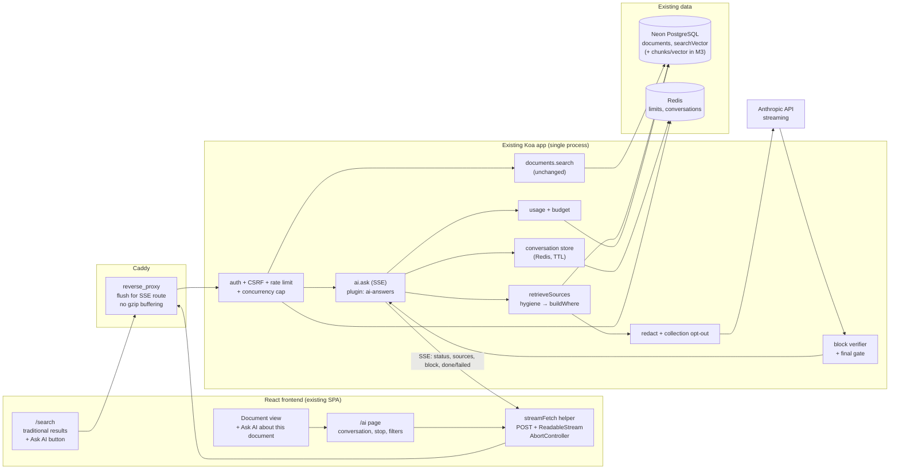

# TIN Knowledge Base — AI Search: Final Architecture and Milestone Plan

**Status:** Planning only. Nothing implemented, installed, migrated, committed or deployed. Awaiting owner approval of the decisions in section E before Milestone 1.
**Basis:** the read-only audit ("Split AI Search out, then stream verified blocks"), re-verified against the repository and production on 2026-10-13/14, plus the earlier model-strategy research and the v2 plan (`2026-10-13-ai-answers-v2-measure-verify-budget.md`).

## 0. Verdict first

The architecture is feasible on the existing stack, and the four milestones are achievable in the order you gave, with **three adjustments** that the evidence forces:

1. **Milestone 1 must also release the database connection during model calls.** I verified that every authenticated request is wrapped in a request-pinned tenant transaction held until the route finishes (`server/middlewares/authentication.ts:115-135`). Production runs one process (`WEB_CONCURRENCY=1`), the default pool of 5 connections (`DATABASE_CONNECTION_POOL_MAX` unset, `server/storage/database.ts:57`), and a 10 s socket timeout (`REQUEST_TIMEOUT` unset → `server/env.ts:328-329`, applied at `server/main.ts:146`). Five concurrent 3–8 s AI answers can therefore starve **every** request in the process, and the 10 s timeout turns the wait into 502s.
2. **A small amount of retrieval hygiene moves from Milestone 3 into Milestone 2.** Follow-up questions are only as good as retrieval, and the fixes (slug tokens, 2-letter terms, no popularity boost, AND-then-OR) are plugin-local and do not touch traditional Search. pgvector stays gated in Milestone 3.
3. **Conversation state lives in Redis with a short TTL, not in the database.** It satisfies "server-managed, never trust the client" with no migration in Milestone 2; persistent history (tables, sidebar) stays in Milestone 4.

**A correction to something I told you earlier.** When production calls returned 502 after exactly ~10 s, I attributed it to this browser pane's HTTP/3 connection. The new evidence (a 10 s `REQUEST_TIMEOUT`, pool of 5, request-pinned transactions held during model calls, and my own page loads launching several 5–8 s answer requests that were never cancelled) makes **server-side saturation the more likely cause**. Both are plausible; the first task in Milestone 1 is to measure which. The finding matters because real usage is concurrent.

---

## A. Final Architecture

### Three experiences, one shared core

| Experience | Purpose | Route | Backend | Changes |
|---|---|---|---|---|
| **Search** | Fast document discovery | `/search` (existing) | `documents.search`, `documents.search_titles` (unchanged) | Remove the auto answer card; add a flag-gated **Ask AI** button that opens `/ai?q=…&collectionId=…&documentId=…` |
| **AI Search** | Conversational, streamed, cited answers | `/ai` (new SPA route, sidebar item) | `POST /api/ai.ask` (SSE), `POST /api/ai.cancel` optional | New page + new plugin route in `plugins/ai-answers` |
| **Documents** | Existing browse/edit/collaborate | existing | existing | One flag-gated menu action: **Ask AI about this document** → `/ai?documentId=…` |

**Shared core (all three):** the authenticated session and RBAC; `SearchProviderManager.getProvider().searchForUser` / `buildWhere` (`plugins/search-postgres/server/PostgresSearchProvider.ts:627-705`) as the *only* retrieval gate; the Outline `documents` table and its `searchVector`; the plugin's provider contract + verifier (v2 Task 1).

### Request flow for one AI turn

1. Client `POST /api/ai.ask` `{ conversationId?, query, collectionId?, documentId? }`. Auth, CSRF header and rate limit as for any API call.
2. Server loads the conversation from Redis (if any), verifies it belongs to this user and team, and **re-authorizes** every document id referenced by earlier turns.
3. Retrieval (short, explicit tenant transaction): standalone-query rewrite (cheap, deterministic first: previous question + still-readable cited titles; a model rewrite only if evaluation shows it is needed), keyword/trigram retrieval, section selection, secret redaction. **The transaction is released before the model is called.**
4. Server emits SSE `status: searching` → `sources` (authorized titles/collections only) → `status: generating`.
5. The model streams. A per-block verifier releases a block only when it passes (cited, or a verbatim copy, or a structural element that carries no claim). Released blocks are emitted as `block` events with their citations resolved to document URL + heading anchor.
6. On completion the verifier runs the final gate (clean finish, at least one real citation, no sentinel). Server emits `done` (with usage and timings) or `failed` (with a reason the UI shows next to the partial answer).
7. The turn (question, verified answer text, cited document ids, usage) is appended to the Redis conversation; a metadata-only usage row is written; **no answer text is stored in `search_queries`**.

### Components

- **Provider contract and verifier** (v2 Task 1, extended): `AnswerProvider.stream()` yields `ProviderEvent`s; `verifyBlock()` is pure and per-block; `verifyFinal()` runs the gates that need the whole message.
- **Redaction module** (`redact.ts`, pure): detects credential-shaped content and replaces it with `[REDACTED]` before sending to the provider and again on output and citations.
- **Conversation store** (`conversation.ts`): Redis, key `aiconv:{teamId}:{userId}:{id}`, TTL 60 min sliding, max 8 turns, history budget ≈ 6k tokens. Server writes it; the client only holds the id.
- **Usage and budget** (v2 Tasks 2–3): `ai_answer_usages` table, per-workspace monthly cap, concurrency cap.
- **Collection opt-out**: `collections.aiExcluded` boolean (additive migration) checked in retrieval, honored for AI only.

### Conversation handling (the follow-up requirement)

"How does it connect to Lifescape?" is resolved server-side:
- The conversation holds prior questions and prior verified answers with the document ids they cited.
- For the new turn, the standalone query is built from the previous question(s) and the **titles of previously cited documents that the user can still read**. "It" resolves to "BOSS API" because that was the subject of the prior question and the cited title.
- Retrieval is re-run with the user's **current** permissions. Prior answer text is included in the model context **only if every document it cited is still readable now**; otherwise only the earlier question is kept. Nothing assistant-authored comes from the client.

### Safe structured answers (the verifier evolves, it does not weaken)

Allowed output: paragraphs, headings, bold/italic, bullet and numbered lists, tables, inline code, code blocks. Not allowed: HTML, images, embeds, **model-written links** (citations and links are generated by the server from verified source ids), raw URLs are rendered as plain text.

Block classes and rules:

| Block | Rule | Why safe |
|---|---|---|
| Claim paragraph / list item / table row | must carry at least one provider citation that resolves to a section **that was sent**, or be a verbatim copy (≥25 chars) of a sent section | unchanged from v1.2 |
| Heading, table header row, step lead-in | allowed uncited only if short (≤80 chars) and containing **no URL, no email, no digits-as-claims, no code-like or identifier tokens** not present in the sent sections | structure without smuggling claims |
| Code block | must be a verbatim substring of a sent section | no invented commands |
| Any block | after redaction; no markdown link/image syntax survives; novel URLs/emails not present in sources are removed or the block is dropped | exfiltration controls |

General-knowledge statements: the prompt requires the model to say what is **not** covered by the documents, and the UI labels any sentence that cannot be tied to a source as "not from your documents" only if the product owner opts into general knowledge (decision D7: recommended off).

### Retrieval

- **Milestone 2 (hygiene, plugin-local, no DB change):** split slug/path tokens (`mvanhorn/cli-printing-press` → `mvanhorn`, `cli`, `printing`, `press` *and* the compound), keep 2-letter terms (AI, HR, QA) when upper-case or quoted, no popularity boost for AI retrieval, AND first and OR as fallback, trigram title fallback using the already-installed `pg_trgm`.
- **Milestone 3 (gated by evaluation):** hybrid keyword + vector + trigram fused with reciprocal rank fusion inside the existing Neon PostgreSQL; chunk table with `teamId` + tenant policy; exact scan is fine at ~2.3M characters (≈2k chunks).
- **Freshness:** the index is built from the deprecated `text` column refreshed by `DocumentUpdateTextTask` after collaborative edits (`server/queues/tasks/DocumentUpdateTextTask.ts`), with collaboration saves debounced 3–10 s (`server/services/collaboration.ts:46-48`). Milestone 1 measures the real lag; Milestone 3 fixes it by refreshing the vector for the changed document on the task, not per keystroke.

---

## B. Architecture diagram

Key property: **one retrieval gate**. Search, AI Search and "Ask AI about this document" all end in `buildWhere`; the AI path adds redaction, opt-out and verification on top and never reads documents any other way.

---

## C. Final feature specification

### 1. Search (`/search`)
- Unchanged results, filters, sorting, previews and navigation; performance preserved.
- **Ask AI** button next to the query box (and as a result-list footer), visible when the AI Search flag is on. It carries the query, collection filter and document filter to `/ai`.
- No answer card, no extra request on search (removes a model call per search and the 10/min 429s).

### 2. AI Search (`/ai`)
- **Layout:** header with scope chips (collection, document), message list, composer. On mobile the composer is sticky and scope chips collapse into a menu.
- **States:** idle suggestions; `Searching your documents…`; `Writing answer…` with a Stop button; streamed blocks appear as verified; `Sources` panel after retrieval and a consolidated list under the answer; `No relevant documents found` (with the scope that was searched and a hint to widen it); `Couldn't fully verify this answer` shown inline next to partial content with the reason; `Stopped`; error with retry; `Too many requests, try again in N seconds`.
- **Answers:** adaptive structure (short for factual questions; overview/details/integrations for product questions; steps for how-to; table for comparisons; diagnosis/causes/fixes for troubleshooting; synthesized with multiple citations for multi-document), rendered as safe Markdown.
- **Citations:** numbered inline markers [1], [2] linked to the source list; each source shows document title, collection, and a link to the cited **section anchor** (using `shared/editor/lib/headingToSlug.ts`). A citation is shown only if its section was sent to the model and the viewer can read the document.
- **Follow-ups:** same page, same `conversationId`; scope persists until changed; "New conversation" clears state.
- **Filters:** collection and single-document scoping (reusing `authorizeFilterFields`/`expandDocumentIdLeaves`).
- **Accessibility:** `aria-live="polite"` region with `aria-busy` while streaming, keyboard submit/stop, focus management.

### 3. Documents
- Existing experience untouched. A flag-gated **Ask AI about this document** action is added through the existing action/menu system (clone of `searchInDocument` in `app/actions/definitions/documents.tsx:1119-1145`, listed in `useDocumentMenuAction.tsx`). It navigates to `/ai?documentId=…`.

### Navigation
Home · Search · **AI Search** · Drafts · Collections · existing document tree. The item appears only when `TeamPreference.AISearch` and `env.AI_ANSWERS_ENABLED` are both on.

---

## D. Revised implementation plan

Conventions for every milestone: feature flags (`TeamPreference.AISearch`, default off; env `AI_ANSWERS_ENABLED`); the existing `documents.answerQuestion` and `AnswerCard` are **kept** until the replacement is validated and removed only in a later, separate PR; each milestone ends with a rollback tag of the previous image; migrations are additive with `down()`; TDD per task using the superpowers task-plan format at the start of each milestone.

### Milestone 1 — Security and Foundations (release-blocking)

**Goal:** make the feature safe to expand, and measure before changing.

| # | Work item | Files / components | API / DB |
|---|---|---|---|
| 1.1 | Measure first: time and token logging, pool-wait and 10 s-timeout evidence, search `EXPLAIN ANALYZE` on the 148-document workspace, stale-index count, SSE probe through real Caddy | `plugins/ai-answers/server/api/answers.ts`, new `ai.ping` probe route (flag-gated) | none |
| 1.2 | **Release the DB connection before the model call** (spike then implement): authenticate without holding the pinned transaction for AI routes; run retrieval in short explicit tenant transactions; write usage after | `server/middlewares/authentication.ts:115-135` (opt-out path), plugin routes | none |
| 1.3 | Request lifecycle: per-route timeout / heartbeat so the 10 s socket timeout cannot cut AI responses; abort model stream on client close | `server/main.ts:146`, `server/routes/mcp/index.ts:183-211` pattern, plugin route | none |
| 1.4 | **Secrets:** pure `redact.ts` (patterns for API keys/tokens/private keys/JWTs/password-assignments + high-entropy heuristic) applied before send and to output and citations; unit tests with a corpus of true/false positives | `plugins/ai-answers/server/redact.ts` | none |
| 1.5 | **Per-collection AI exclusion** + default exclusion of collections matching `credential|secret|password|token|api[-_ ]?key` (owner confirms the list) + settings toggle on the collection edit form | `server/models/Collection.ts`, migration, `app/components/Collection/CollectionForm.tsx`, `plugins/ai-answers/server/retrieve.ts` | migration: `collections.aiExcluded boolean not null default false` |
| 1.6 | **Stop storing answer text**: write `answer` only as null; keep question and metadata; usage row instead | `plugins/ai-answers/server/api/answers.ts` | none |
| 1.7 | Existing stored answers: **count-only scan** inside the container (no content printed), report affected row ids; with approval, null the flagged rows (and optionally everything older than N days); reduce `CleanupOldSearchQueriesTask` retention for answered rows | one-off script outside the repo, `server/queues/tasks/CleanupOldSearchQueriesTask.ts:14` | data change only after approval |
| 1.8 | Metering + per-workspace budget + concurrency cap + fail-closed limiter for AI routes (v2 Tasks 2–3) | `usage.ts`, `pricing.ts`, migration `ai_answer_usages` | migration (tenant policy) |
| 1.9 | Provider contract + per-block verifier + final gate (v2 Task 1 extended); evaluation harness baseline (v2 Task 4) | `contract.ts`, `verify.ts`, `providers/anthropic.ts`, `eval/` | none |
| 1.10 | API scope: register the AI route explicitly in the scope map (`shared/helpers/AuthenticationHelper.ts:16-30`) | `AuthenticationHelper.ts` | none |

**Acceptance:** permission and tenant tests pass (retrieval never returns another team's or unreadable documents; redaction removes seeded fake secrets from the request payload and from output; excluded collections never reach the provider; a forged citation index never surfaces an unsent section); 10 concurrent AI requests do not delay a concurrent `documents.search` beyond 500 ms (benchmark); metering rows contain no text; baseline eval numbers recorded for the current model.
**Risks:** the transaction change touches authentication (highest-risk change in the program) → spike first, small diff, full existing suite, rollback tag. **Rollback:** previous image; flags off; migrations have `down()`.
**Effort:** 5–8 working days (the transaction spike is the main uncertainty).

### Milestone 2 — Complete AI Search experience

| # | Work item | Files / components | API / DB |
|---|---|---|---|
| 2.1 | Streaming endpoint `ai.ask` (SSE over POST): events `status`, `sources`, `block`, `done`, `failed`; compression disabled for the route; heartbeat; cancel on close | new `plugins/ai-answers/server/api/ask.ts`; `server/services/web.ts:72` (per-route `ctx.compress = false`); Caddyfile only if the probe shows buffering | new route; flag-gated |
| 2.2 | Conversation store in Redis; standalone-query builder; re-authorization of prior citations each turn | `conversation.ts`, `retrieve.ts` | Redis only |
| 2.3 | Adaptive structured prompt + safe-Markdown block verifier (block classes above); `max_tokens` raised; no sentence-count limits | `contract.ts` (system prompt), `verify.ts` | none |
| 2.4 | Retrieval hygiene (slug tokens, 2-letter terms, no popularity boost, AND→OR, trigram title fallback) | `text.ts`, `retrieve.ts` | none (uses installed `pg_trgm`) |
| 2.5 | Frontend streaming helper (fetch + reader + CSRF + AbortController) | new `app/utils/streamFetch.ts` | none |
| 2.6 | AI Search page + sidebar item + route + `useAIAnswersEnabled()`; Markdown rendering via the read-only `Editor` with a curated extension list (no Image/Embed/Attachment/Video; no model links) | `app/routes/scenes.ts`, `app/routes/authenticated.tsx`, `app/utils/routeHelpers.ts` (`aiPath`), `app/components/Sidebar/App.tsx:131-138`, new `app/scenes/AISearch/*`, reuse of `components/Editor` as in `HoverPreviewIssue.tsx:66-72` | none |
| 2.7 | Search: remove auto card, add **Ask AI** button | `app/scenes/Search/Search.tsx:38, 400-409` | none |
| 2.8 | Documents: **Ask AI about this document** action | `app/actions/definitions/documents.tsx:1119-1145`, `app/menus/useDocumentMenuAction.tsx:118` | none |
| 2.9 | Feedback buttons (moved from v2 Task 5) on the AI page | `app/scenes/AISearch/*` | existing `searches.update` or usage table |

**Acceptance:** first verified text visible within 3.5 s at p75 on Sonnet through the real proxy path (stretch 3 s); stop button cancels the model call (usage shows truncated tokens, server log shows abort); follow-up "How does it connect to Lifescape?" resolves "it" in a scripted conversation test; revoked permission between turns removes that document's prior answer text from context; `aria-live` region present; mobile layout checked at 375 px; Search page makes no AI request; old endpoint still works.
**Risks:** proxy buffering (mitigation: probe in M1, per-route settings); partial answers confusing users (mitigation: explicit `failed` state); verifier too strict for tables (mitigation: evaluation set includes comparison cases; tune before enabling). **Rollback:** flag off hides the page and Ask AI entries; the old endpoint remains.
**Effort:** 8–12 working days.

### Milestone 3 — Retrieval and indexing improvements

| # | Work item | Files | DB |
|---|---|---|---|
| 3.1 | Retrieval quality evaluation on a real, consented question set; decide go/no-go for vectors on the numbers | `eval/` | none |
| 3.2 | If go: `CREATE EXTENSION vector` (approval), `document_chunks` table (teamId, tenant policy, embedding, chunk text hash, model id), indexer on the document-updated task path, deletion on delete/permission change | migration, new task, `retrieve.ts` | migration + extension |
| 3.3 | Hybrid fusion (full text + vector + trigram, reciprocal rank fusion) through `buildWhere`; rerank only if evaluation shows value | `retrieve.ts` | none |
| 3.4 | Freshness: refresh changed document's search vector/chunks promptly after persistence (debounced), not per keystroke | `DocumentUpdateTextTask.ts`, collaboration persistence path | none |
| 3.5 | Optional answer-level cache keyed by user, scope, permitted-document set and document revisions (no semantic cache) | plugin | Redis |

**Acceptance:** recall@5 and answer-correctness on the evaluation set improve versus the M2 baseline by an agreed margin (proposed ≥15 points on the definitional and multi-source strata), with no regression on unanswerable and injection cases; stale-index window under 30 s at p95; traditional Search unchanged. **Rollback:** disable hybrid by flag; chunks table can be dropped; the extension can remain unused.
**Risks:** embedding vendor sends content off-server (decision D6); approximate-index filtering (avoided by exact scan at this size). **Effort:** 5–8 working days.

### Milestone 4 — Production optimization

Persistent conversation history and sidebar (tables with tenant policy, retention setting, redaction-on-store), advanced feedback and analytics over `ai_answer_usages`, admin budget UI, performance tuning (effort/context trimming, prompt caching where metering shows hits), evaluation in CI (nightly or on prompt changes). **Effort:** 6–10 working days.

### Dependency check on your sequence
M1 → M2 is a hard dependency (streaming and conversation multiply the connection-hold and cost risks). M3 can start in parallel with late M2 only for the *evaluation* work. M4's persistent history depends on M2's conversation shape but not on M3.

### Performance expectations (honest)

| Target | Realistic? | Basis |
|---|---|---|
| Traditional search < 500 ms | Yes, met today (128–270 ms measured server round trip) | measured |
| First **verified** text in 1–3 s | **Partly.** Model prefill of ~15k tokens plus the first complete block usually lands at 2–3.5 s; 1–2 s only for short or abstaining answers | estimate, to confirm in 1.1 |
| Typical completion in 3–8 s | Yes for short and medium answers; long structured answers (600–900 tokens) will take 8–12 s | estimate from measured 2.5–7.9 s |

Block-level verification adds up to one block's generation time before text appears; that is the price of not showing unverified content.

---

## Verification of the audit's claims (done against the repository)

| Claim | Verified | Evidence |
|---|---|---|
| Compression middleware sits before `/api` | Yes | `server/services/web.ts:72` `app.use(compress())` |
| 10 s idle socket timeout | Yes, default | `server/main.ts:146`, `server/env.ts:328-329`; production `REQUEST_TIMEOUT` unset |
| Request-pinned tenant transaction held until route completes | Yes | `server/middlewares/authentication.ts:115-135` |
| Pool size | Yes, default 5, production unset, one process | `server/storage/database.ts:57`; container env |
| Rate limiter fails open on Redis errors | Yes | `server/middlewares/rateLimiter.ts:79-85` |
| Unmapped route methods default to write scope | Yes | `shared/helpers/AuthenticationHelper.ts:6,16-30` |
| SDK emits `citation` events inside text blocks while streaming | Yes | `node_modules/@anthropic-ai/sdk/lib/MessageStream.js:386-390` |
| Raw streaming precedent exists | Yes | `server/routes/mcp/index.ts:183` `ctx.respond = false` |
| Answers retained 365 days | Yes | `server/queues/tasks/CleanupOldSearchQueriesTask.ts:14` |
| Heading anchors available for section links | Yes | `shared/editor/lib/headingToSlug.ts` |
| pgvector available, `pg_trgm`/`unaccent` installed | Yes (production, read-only) | extension list, version 0.8.6 not installed |
| Index lag up to ~5 min | Plausible from code (text refreshed by `DocumentUpdateTextTask`); **not measured** | to measure in 1.1 |
| Caddy gzip may buffer SSE | **Unconfirmed** | probe in 1.1 |

## E. Open decisions (only those that need you)

| # | Decision | Options | Recommended | Why / implications |
|---|---|---|---|---|
| D1 | **Authorize work in the production Outline repository** for Milestone 1 (the standing rule treats it as read-only except for explicitly approved work) | (a) this repo, one branch per milestone; (b) `implexus-kb` first, then port | (a) | the feature already lives here and deploys from here; (b) doubles merge work. Each milestone's PR is reviewed before merge. |
| D2 | **Secrets stance** | (a) per-collection exclusion + default-exclude by name + redaction; (b) redaction only; (c) disable AI for the workspace until credentials are removed | (a) | (b) misses unknown patterns; (c) blocks the feature. Needs your list of excluded collection names. |
| D3 | **Stored answers**: stop storing text and purge existing flagged rows | (a) stop storing + purge flagged (count-only scan first, then you approve); (b) stop storing, keep history; (c) keep as is | (a) | removes the largest secrets-retention risk; purge is a production data change requiring your approval after seeing counts only. |
| D4 | **Conversation state** | (a) Redis TTL, server-held; (b) signed stateless token; (c) database tables now | (a) | no migration, auto-expiry, cannot be forged; (c) is Milestone 4. A Redis flush loses live conversations (acceptable). |
| D5 | **Model and budget** | keep Sonnet 5.5 with a monthly per-workspace cap; or Haiku once the evaluation proves parity | keep Sonnet, cap e.g. $25 per workspace per month until metering shows real cost | quality first; at the estimated $0.03–0.05 per answer the cap is ~500–800 answers. You pick the number. |
| D6 | **Embedding vendor and enabling pgvector** (Milestone 3 gate only) | Voyage, OpenAI EU, Mistral EU, or a small self-hosted model | decide after M3.1 shows recall gaps | content leaves the server for embedding; self-hosting on the existing host is possible at this corpus size. Not needed before M3. |
| D7 | **General-knowledge answers** | off (documents only) / labelled | off | your requirement is strict grounding; labelling can come later |
| D8 | **Who can use AI Search; guests** | members only; admins first; guests off | members, guests off at launch | guests see only shared content but credentials risk is higher; revisit after M2 |
| D9 | **Zero data retention / EU processing with Anthropic** | request ZDR (available, citations eligible); no first-party EU option | request ZDR | client data in documents; ZDR excludes Batch API (eval runs need handling) |

Trivial choices that follow existing conventions are not listed (rate-limit numbers, copy, icon, route name).

## F. Implementation readiness

**Ready for Milestone 1 once D1, D2, D3(a: scan only) and D5 are answered.** No blocker is technical.

Unresolved items, all inside Milestone 1 by design:
1. The transaction-release change is the single riskiest edit; it is a spike with a go/no-go before implementation.
2. SSE through Caddy is unconfirmed; the probe route settles it.
3. Index lag and the 502 diagnosis (server saturation vs client connection) need measurement; the first task produces the numbers.
4. There is no staging environment. Migrations are additive and tested on local and CI databases; production receives them through the deploy with the rollback tag. If you want a real staging copy, that is a separate infrastructure decision, not required for M1.

**Conflicts identified:** (1) the production-repo read-only rule vs this work → D1; (2) the v2 plan's Task 5 (feedback on the old card) → moved to M2.9; (3) CLAUDE.md "do not add translation strings manually" → UI copy uses `t()` literals only; (4) the old `documents.answerQuestion` stays until the new path is validated, which keeps its known gaps (stored answers, scope default) until M1.6/M1.10 fix them for both routes.

**Waiting for your explicit approval before beginning Milestone 1.**
